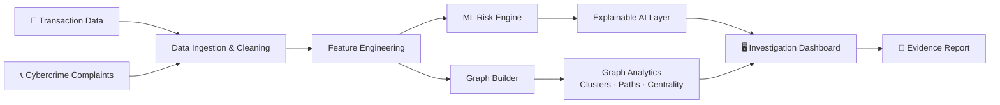

<div align="center">

# 🛡️ CyberShield_Bihar

### AI-Powered Mule Account Detection & Financial Fraud Investigation Platform

**Detect early. Trace fast. Explain every decision.**


[🚀 Quick Start](#-quick-start) · [🧠 How It Works](#-how-it-works) · [✨ Features](#-key-features-mapped-to-ps-01-requirements)

</div>

---

## 📌 The Problem

Mule bank accounts receive, layer, and withdraw proceeds of cybercrime, hiding the origin of illicit funds. Today's detection relies on **fixed thresholds and manual analysis**, so suspicious accounts and organised fraud rings are identified **late**, after the money is gone.

## 💡 Our Solution

**CyberShield_Bihar** is an end-to-end investigation platform that combines **Machine Learning** and **Graph Analytics** to:

- 🔍 **Detect** suspected mule accounts early using behavioural patterns, not static rules
- 📊 **Score** every account with a dynamic, **explainable** risk score
- 🕸️ **Trace** money trails across intermediary accounts and connected entities
- 🔗 **Correlate** transactions with multiple cybercrime complaints
- 🧭 **Guide** investigators with prioritised leads inside a single dashboard

> Built so that banks and law-enforcement agencies can **act on high-risk accounts before funds disappear**.

---

## ✨ Key Features (Mapped to PS-01 Requirements)

| # | Requirement | What CyberShield_Bihar Does |
|---|-------------|-----------------------------|
| 1 | **Transaction Analysis** | Flags unusual patterns, rapid pass-through transfers, layering behaviour and deviations from an account's normal baseline |
| 2 | **Mule Account Detection** | ML-based dynamic risk scores, ranked suspicious accounts, and per-account indicator breakdown |
| 3 | **Money Trail Analysis** | Follows fund movement hop-by-hop to find intermediary accounts, connected entities and suspicious transaction chains |
| 4 | **Complaint Correlation** | Links transactions to multiple cybercrime complaints to reveal related incidents, accounts and entities |
| 5 | **Graph-Based Investigation** | Interactive visualisation of account relationships, suspicious clusters and organised criminal networks |
| 6 | **Investigation Dashboard** | Risk-based alerts, prioritised leads, transaction timelines, network views and evidence-based reports |

---

## 🧠 How It Works



### 1️⃣ Risk Scoring Engine
Behavioural features such as velocity, pass-through ratio, in/out balance, dormant-to-active spikes, fan-in / fan-out and counterparty diversity feed an ML model that produces a **0–100 risk score** per account.

### 2️⃣ Explainable AI
Every score ships with the **top contributing indicators** (SHAP-style), so an investigator can see *why* an account is flagged and defend it in a report.

### 3️⃣ Graph Analytics
Accounts are nodes, transactions are edges. We run community detection, shortest-path / multi-hop tracing and centrality analysis to surface **mule rings and hub accounts**.

### 4️⃣ Complaint Correlation
Complaint records are matched against account and transaction entities so that **one victim report can expose an entire network**.

---

## 🛠️ Tech Stack

| Layer | Technology |
|-------|-----------|
| Frontend | React, Tailwind CSS, Graph visualisation (Cytoscape.js / D3) |
| Backend | Python, FastAPI |
| ML / XAI | scikit-learn, XGBoost, SHAP |
| Graph | NetworkX / Neo4j |
| Database | PostgreSQL / Supabase |
| Reports | PDF export of evidence-based case reports |

> ✏️ *Update this table to match your final implementation.*

---

## 🚀 Quick Start

```bash
# 1. Clone the repository
git clone https://github.com/GautamArashi/CyberShield_Bihar.git
cd CyberShield_Bihar

# 2. Backend setup
cd backend
python -m venv venv
source venv/bin/activate        # Windows: venv\Scripts\activate
pip install -r requirements.txt
uvicorn app.main:app --reload

# 3. Frontend setup (new terminal)
cd frontend
npm install
npm run dev
```

Open **http://localhost:5173** to view the dashboard.

---

## 📁 Project Structure

```
CyberShield_Bihar/
├── backend/
│   ├── app/
│   │   ├── api/            # REST endpoints
│   │   ├── ml/             # Risk model & feature engineering
│   │   ├── graph/          # Graph building & analytics
│   │   └── explain/        # Explainable AI layer
│   └── requirements.txt
├── frontend/
│   └── src/                # Dashboard, graph view, timelines
├── data/                   # Synthetic / sample datasets
├── docs/                   # Architecture & screenshots
└── README.md
```

---

## 🌍 Impact

- ⏱️ **Earlier detection**: catch suspicious accounts before layering completes
- 💰 **Reduced financial losses**: prioritise the highest-risk accounts first
- 🔎 **Faster investigations**: money trails traced in seconds, not days
- 🤝 **Better coordination**: one shared view for banks and law-enforcement
- ⚖️ **Trustworthy AI**: every alert is explainable and evidence-backed

---

## 🔐 Data & Privacy

- Uses **synthetic / anonymised data** for the hackathon prototype
- Role-based access and audit trail planned for production use
- Explainability ensures decisions remain **human-reviewable**, not black-box

---

## 🗺️ Roadmap

- [x] Problem analysis & architecture design
- [ ] Transaction feature engineering
- [ ] Mule risk scoring model
- [ ] Graph-based money trail tracing
- [ ] Complaint correlation module
- [ ] Investigation dashboard
- [ ] Evidence report export
- [ ] Real-time streaming alerts

---

<div align="center">

**Built with ❤️ for Cyber Hackathon Bihar 2026**

⭐ Star this repo if you believe fraud networks should be caught before the money disappears.

</div>
